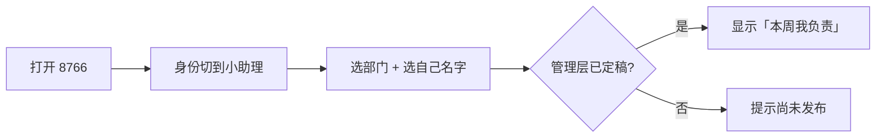

# 校素拓 · 学生组织工作安排平台

面向全校学生组织（校素拓 6 部门 + 19 个二级学院素拓机构，约 120 个机构）的**工作安排自动化**开源平台。
核心只做一件事：**把「这件活派给哪个干部」自动化**——公平、可解释、长期均衡、换届可传承。

> 定位铁律：到梦空间 / i 志愿已占「面向学生的活动发布 / 报名 / 签到 / 学分」，本平台**只做机构内部派活**；
> 规划部 / 认证部的核心工作在教务系统上，不做。

📘 **新手先看 [使用指南.md](使用指南.md)** —— 本地运行、管理层 / 小助理分区、派活与导出的一步步图文说明。

## 特性

- **部门层**：顶栏选部门进入对应工作台；派活型 / 排班型 / 排期型 / 招募型四种原型，接一个新部门 = 填一份配置，原则上零代码改动。
- **公平可解释**：确定性排序链（sort chain），规则逐级比较、可读、可增删；每格分配都给出「为什么是他」的人话解释。
- **长期均衡**：50 周模拟人均累计极差仅 **1 件**、标准差 **0.24**，单周无人超过 2 件。
- **可复现**：分配由 `sha256(周次|重摇|人员id)` 稳定哈希裁决，不依赖 `random`——给定输入永远同一张表，可审计。
- **回避硬过滤**：角色冲突类约束（如认证部「不能查自己学院」）做成硬过滤，而非可加权排序的软偏好。
- **官方版式导出**：直接生成对齐官方安排表样式的 xlsx（纯文本、无边框底色，可粘贴进群）。

## 架构

```
项目根/
├── 04_Web端/        周工作自动化工作台（拆分/安排/台账/看板/说明），独立 FastAPI + 静态前端，端口 8765
├── 05_工作安排/      工作安排台（部门层 + 落地页 + 分支接入），端口 8766
│   ├── engine/         FastAPI 后端
│   │   ├── core/        models.py（部门层 OrgRegistry）/ assigner.py（排序链内核）/ exporter.py（导出）
│   │   ├── main.py      API 路由（全部带 ?dept=）
│   │   └── stats.py     公平性实测报告（python stats.py → FAIRNESS_REPORT.md）
│   └── web/src/       前端（落地页 + 分支 + 派活台），TypeScript
├── 06_通用平台规划/   调研 / 方案 / 行动卡
└── 启动全部.bat       一键拉起 04（8765）与 05（8766）
```

**排序链内核**（`engine/core/assigner.py`）：规则写成一串 `sort` 逐级比较，不加权求和——
`上周回避 → 累计件数（历史+本周）→ 本校区优先 → 确定性哈希`。
增删规则 = 加一个 `_rule_xxx` 方法 + 把名字写进 `SORT_CHAIN`。

## 本地运行

### 前置依赖
- **Python 3.10+**（后端 FastAPI）。`python --version` 确认。
- **Node.js 18+**（前端构建；已构建好的 `web_dist` 可直接被后端托管，纯运行可不装 Node）。
- 本机有网络（首次 `pip install -r` 装依赖；依赖见各目录 `requirements.txt`）。

### 启动
```bash
# 方式一：一键启动两个平台（推荐）
双击 启动全部.bat        # 自动开浏览器到 http://127.0.0.1:8766/

# 方式二：分别启动
cd 04_Web端  && 启动.bat   # 8765
cd 05_工作安排 && 启动.bat  # 8766
```
> Windows 双击 `.bat` 即可；其它系统用 `python launch_all.py`（等价）或各目录的启动脚本。

### 访问地址
- **05_工作安排（落地页 / 派活台）**：http://127.0.0.1:8766 —— 选部门进入工作台。
- **04_Web端（周工作自动化台）**：http://127.0.0.1:8765 —— 由 05 落地页「质检部 Web 端」嵌入，也可直接访问。

进入 8766 落地页 → 点「质检部」→ 选「工作安排类」（派活台）或「质检部 Web 端」（整屏嵌入 04）。

### 角色入口
- **管理层**：落地页顶部切「管理层」→ 输口令（默认 `sutuo`，首次请改）→ 进派活台排班。
- **小助理**：落地页顶部切「小助理」→ 选部门 + 自己名字 → 只读「本周我负责」（详见下方「角色分区」）。

## 快速开始（开源协作）

```bash
git clone https://github.com/baomi888/School-Quality-Development-Work-Platform.git
cd School-Quality-Development-Work-Platform
# 本地运行见上方「本地运行」；提交代码后：
git push -u origin master --tags
```

## 角色分区（管理层 / 小助理）

落地页顶部可切换身份，分成两个互不越权的入口：

- **管理层入口**：进入需输入**管理口令**；所有会改数据的接口（派活 / 提交 / 导出 / 改名单 / 建部门）服务端都校验口令（`X-Manage-Key` 头）。小助理没有口令，既进不了界面，也调不动接口。
- **小助理入口**：只读视图「本周我负责」——选自己的名字，只能看到管理层已提交的、属于自己的任务（含校区 / 备注），**不能自行改派、不能进管理层接口**。

> ⚠️ 默认管理口令为 `sutuo`（开源占位）。首次进入后请点工作台右上角「修改口令」改掉；
> 口令只存本机 `engine/data/manage_key.txt`（已被 `.gitignore` 排除，不进仓库）。

### 小助理怎么用（一步步）

1. 打开 `http://127.0.0.1:8766` → 落地页**顶部把身份切到「小助理」**。
2. 选**部门**（如「质检部」）→ 选**自己的名字**（名单来自管理层维护的人员表）。
3. 进入「本周我负责」只读视图：
   - 只显示管理层已 **提交（定稿）** 的、属于你的任务，含「工作内容 / 校区 / 备注」；
   - 管理层还在排、未定稿时，显示「本周安排尚未发布」；
   - 看不到别人的任务，也不能自行改派。
4. 管理层定稿后，把这一页**截图**或直接把地址发群里即可——小助理无需登录、无需口令。



> 管理层侧：落地页切到「管理层」→ 输入口令 → 进派活台排班 → 点「提交」后小助理才能看到。
> 提交前小助理视图为空，可避免半成品提前外流。

## 公平性实测（50 周确定性模拟，脱敏示例名单）

| 指标 | 结果 |
|---|---|
| 人均累计件数 | 均值 52.94 / 标准差 0.24 / 极差 **1** 件 |
| 各活忙碌度极差 | **0** 件 |
| 单周最大负载 | **2** 件/人 |
| 上周同活重复 | **11** 次 / 共 900 格·周 |

> 用脱敏示例名单跑出，算法对真实名单一致。`_probe_random.py` / `_probe_sortchain.py` 为 CI 公平性门禁
> （纯 Python、秒级、非零退出即失败）。完整报告见 [`05_工作安排/FAIRNESS_REPORT.md`](05_工作安排/FAIRNESS_REPORT.md)。

## 隐私与开源红线

- **真实姓名永不进仓库**：默认名单一律脱敏为「示例·西城甲」；真实名单只在本机 `engine/data/`，已被 `.gitignore` 排除。
- **内部资料（含真名截图/表格）不入库**：目录 `内部资料/` 整体排除。
- 协议 **MIT**（署名冯靖豪）。转载 / 二次发布请保留 `LICENSE` 与版权声明。
- 第三方代码红线：GPL-3.0 / AGPL-3.0 项目（SU-Scheduler、dienstplan-apotheke）**只能读思路，绝不抄代码**；
  medshift（MIT）可参考，须署名并保留其 LICENSE。

## 路线图

- [x] 质检部（派活型）接入 + 部门层 + 落地页 + 分支接入 + 综合启动
- [x] 认证部预填名单 + 回避硬过滤框架
- [x] 管理层 / 小助理分区（口令保护派活接口 + 小助理只读视图）
- [ ] 综合部（排班型）/ 宣传部（排期型）/ 竞赛部（招募型）按机构接入
- [ ] 公平性报告出口 + 无解诊断（哪条规则卡死、改哪个数能解开）
- [ ] 换届传承包（配置 + 名单随下一届导出导入）
